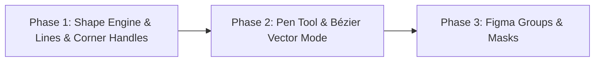

# 🎨 Figma-Grade Vector Canvas Architecture & Design Specification

> **Date:** 2026-11-05  
> **Status:** APPROVED (Collaborative Brainstorming with Boris)  
> **Target Scope:** Deck.CE Slide Canvas Vector System (Shapes, Lines, Pen Tool, Bézier Curves, Groups, Masks)

---

## 1. Executive Summary & Goals

The Deck.CE slide editor requires professional, Figma-grade vector graphics and layout capabilities:
1. **Fix Shape Rendering:** All shapes (Rectangle, Circle, Triangle, Star, Diamond, Polygon) must render real vector geometry with fills (solid, gradient, image) and strokes, eliminating the bug where non-rect shapes rendered as blank/rectangular clip-paths.
2. **True Vector Line Tool (`L`):** 2-point vector primitive with start/end drag handles, 45° angle snapping (`Shift`), stroke styles, and arrowheads (None, Arrow, Triangle, Circle, Diamond).
3. **Interactive 4-Corner Radius:** Visual corner radius handles inside rectangle corners; drag to adjust all corners simultaneously, or hold `Alt` (Option) to adjust individual corners (`TL`, `TR`, `BL`, `BR`).
4. **Pen Tool (`P`) & Vector Edit Mode:** Double-click or `Enter` to enter Vector Edit Mode. Full Bézier curve editing with anchor nodes, tangent handles (`handleIn`, `handleOut`), path closing, and node deletion/addition.
5. **Groups & Masks:** `Cmd+G` / `Cmd+Shift+G` container groups with single-click group selection, deep-click child selection, and Figma masks (`isMask: true`) where the bottom element clips elements above it.

---

## 2. Phased Implementation Roadmap

To maintain strict stability and the project's **Diff Budget (< 450 lines / commit)**, execution is divided into 3 atomic phases:



### Phase 1: Geometry Foundation, Line Endpoints & 4-Corner Handles
- **SVG Shape Engine:** Replace broken div-background + clip-path with a unified SVG rendering pipeline in `ShapeRenderer.tsx`. Fills and strokes are rendered directly on SVG path elements with proper viewBox scaling.
- **Line Primitive:** Convert `stroke` items to support 2-point endpoints (`{ x1, y1, x2, y2 }`). Dragging on canvas draws lines at any angle (`Shift` for 45° snap). Custom handles replace the 8-box resize handles with 2 circular endpoints.
- **Corner Radius Visual Handles:** Inside each corner of a rectangle, render a draggable white handle. Drag adjusts all corners; holding `Alt`/Option adjusts only the hovered corner.
- **Inspector UI:** 4 independent corner input fields in the slide properties panel.

### Phase 2: Pen Tool & Vector Bézier Curve Editor
- **Data Model:** Introduce `ICanvasItemPath` with `nodes: IVectorNode[]` and `isClosed: boolean`.
- **Vector Edit Mode:** Double-click or `Enter` enters vector edit mode. Shows anchor nodes and Bézier tangent handles (`handleIn`, `handleOut`). Toolbar shows "Done" button and `Esc`/`Enter` exits edit mode.
- **Pen Tool (`P`):** Click to add sharp nodes, drag to pull Bézier tangent handles, click start node to close path.
- **Path Operations:** Alt-drag to break tangent symmetry; double-click node to toggle sharp/smooth.

### Phase 3: Figma Groups & Masking System
- **Groups:** Container element (`type: 'group'`) with `childrenIds: string[]`. Single click selects group; double click selects child. `Cmd+G` / `Cmd+Shift+G` shortcuts. Relative child coordinate transformations.
- **Masks:** Any vector shape or text in a group can have `isMask: true`. Above-layers are rendered inside an SVG `<mask id="...">` or `<clipPath id="...">` matching the mask layer geometry.

---

## 3. Data Structures & Types

### 3.1 Extended `ICanvasItem`
```typescript
export interface IVectorPoint {
  x: number; // percentage 0-100 relative to item bounding box
  y: number;
}

export interface IVectorNode {
  id: string;
  x: number;
  y: number;
  handleIn?: IVectorPoint;
  handleOut?: IVectorPoint;
  isCorner?: boolean; // false = smooth, true = sharp
}

export type LineCapType = 'none' | 'arrow' | 'triangle' | 'circle' | 'diamond';

export interface ICanvasItemLine {
  x1: number;
  y1: number;
  x2: number;
  y2: number;
  startCap?: LineCapType;
  endCap?: LineCapType;
}

export interface ICanvasItemPath {
  nodes: IVectorNode[];
  isClosed: boolean;
}
```

---

## 4. UI/UX Interaction Principles

1. **Figma Parity:** Keyboard shortcuts match industry standards (`L` for Line, `P` for Pen, `Cmd+G` for Group, `Cmd+Shift+G` for Ungroup, `Enter` / `Esc` for Vector Edit Mode).
2. **Visual Affordances:** Corner radius handles only appear when selected or hovered; vector handles display directional tangent lines with circular drag heads.
3. **Non-destructive Transforms:** Grouping retains absolute visual positions and bounding boxes of elements.

---

## 5. Verification & Testing Strategy

- **Hermetic Unit Tests:** Vitest tests verifying SVG path generation, bounding box calculation, vector node manipulation, and group transformation math.
- **Regression Prevention:** Existing slide items, text, video, and image layers must render identically.
- **Harness Gates:** `npm run check:types`, `vitest run`, `npm run check:hygiene`, `npm run check:design`, `npm run check:smoke`.

